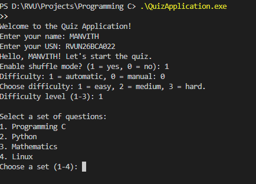
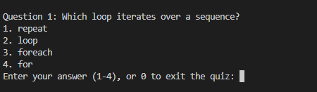
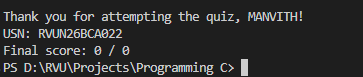

# Quiz Application

A beginner-friendly, terminal-based multiple-choice quiz written in C. It uses
`stdio.h` for input and output and organizes questions into four topics:

- Programming C
- Python
- Mathematics
- Linux

The project practices functions, arrays, loops, conditionals, input validation,
and simple scoring. The question banks are divided into Easy, Medium, and Hard
sections.

## Features

- Collects the student's name and USN.
- Lets the student choose a topic.
- Supports shuffled questions and answer options.
- Supports automatic or manually selected difficulty.
- In automatic mode, adjusts difficulty based on recent answers.
- Randomly selects a question quota of 10–15 for each difficulty round.
- Does not reveal whether an answer is correct immediately.
- Shows the score and reviews incorrect answers after a quiz.
- Allows the student to enter `0` at an answer prompt to exit the quiz early.
- Offers a menu to restart, change topics, continue with another topic, or exit.
- Prints a final thank-you message with the student's name, USN, and score.

> Shuffle is implemented with a small integer-based pseudo-random generator.
> Its sequence is initialized from the student's name, so it is not intended
> for security or cryptographic use.

## Requirements

- A C compiler that supports C99 or later.
- No extra C headers are required; the source includes only `stdio.h`.

## Build and run

From a terminal in the project folder, compile with GCC:

```sh
gcc QuizApplication.c -o QuizApplication
```

Run on Windows:

```powershell
.\QuizApplication.exe
```

Run on Linux or macOS:

```sh
./QuizApplication
```

## How to use

1. Enter your name and USN.
2. Choose whether to shuffle the questions and options.
3. Choose automatic difficulty or select Easy, Medium, or Hard manually.
4. Select a topic.
5. Answer with `1`–`4`, or enter `0` to exit the quiz.
6. At the end, view your score and review any incorrect answers.
7. Use the menu to restart, select another topic, continue scoring, or exit.

In automatic mode, two consecutive correct answers raise the target difficulty.
An incorrect answer lowers it by one level. The quiz continues through its
scheduled difficulty rounds; it does not end early based on a pass mark.

Manual mode asks questions only from the selected difficulty. The number of
questions in a round is selected between 10 and 15, depending on the available
questions in that difficulty bank.

## Question bank format

Each topic function contains separate arrays for Easy, Medium, and Hard
questions. For each difficulty, the question text, four choices, and correct
answer are stored in parallel arrays. Items at the same index belong together,
so keep their order and array lengths aligned when adding or editing a question.

For example:

```c
const char* easyQuestions[] = {
    "What is 2 + 3?",
    "How many sides does a triangle have?"
};

const char* easyOptions[][4] = {
    {"4", "5", "6", "7"},
    {"2", "3", "4", "5"}
};

const int easyAnswers[] = {2, 2};
```

The values in `easyAnswers` are numbered from `1` to `4`, matching the choices
as displayed to the student. If a question is added to `easyQuestions`, add its
four choices at the same position in `easyOptions` and its correct choice at
the same position in `easyAnswers`. Pass the updated question count to
`runQuiz`.

## Functions

| Function | Purpose |
|---|---|
| `main` | Starts the application, launches the selected quiz, displays the menu, and prints the final report. |
| `intake` | Reads the student's name and USN and collects shuffle and difficulty preferences. |
| `programmingC` | Defines the C question banks and starts that topic's quiz. |
| `python` | Defines the Python question banks and starts that topic's quiz. |
| `mathematics` | Defines the mathematics question banks and starts that topic's quiz. |
| `linuxQuiz` | Defines the Linux question banks and starts that topic's quiz. |
| `readInt` | Reads an integer, checks that the input is valid, and enforces a minimum and maximum. |
| `chooseQuestionSet` | Displays the available topics and reads the student's choice. |
| `runSelectedSet` | Calls the function for the selected topic. |
| `runQuiz` | Selects questions by difficulty, optionally shuffles questions and choices, records answers, updates scores, and shows the end-of-quiz review. |
| `displayQuestion` | Prints one question and its four choices. |
| `getAnswer` | Reads a choice from `1`–`4` or `0` to exit the quiz. |
| `calculateScore` | Adds one point when the submitted answer matches the correct choice. |
| `nextRandom` | Produces the next value used by the shuffle and question selection logic. |

### Input validation example

`readInt` is used for menu selections, difficulty choices, and answers. It
rejects non-numeric input and numbers outside the allowed range:

```c
int getAnswer() {
    return readInt("Enter your answer (1-4), or 0 to exit the quiz: ", 0, 4);
}
```

### Score and answer review

`runQuiz` keeps arrays for missed question text, the submitted choice, and the
correct choice. The application prints these only after the quiz ends, rather
than revealing correctness after every answer.

```c
printf("\nReview of incorrect answers:\n");
for (int i = 0; i < incorrectCount; i++) {
    printf("%d. %s\n", i + 1, incorrectQuestions[i]);
    printf("   Your answer: %s\n", selectedAnswers[i]);
    printf("   Correct answer: %s\n", correctAnswers[i]);
}
```

## Menu options

- **Restart this set** — repeats the current topic and resets the accumulated score.
- **Change set** — selects a different topic and resets the accumulated score.
- **Continue with another set** — selects another topic and keeps the accumulated score.
- **Exit** — ends the application and prints the final student report.

## Screenshots

### Welcome and student details



### Question screen



### Final student report




## THANK YOU 😊